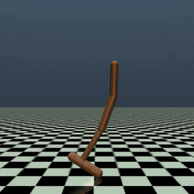
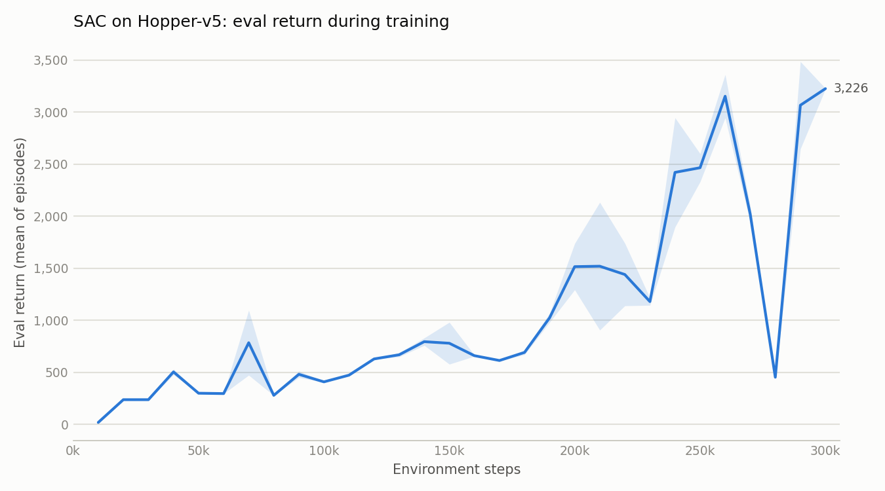
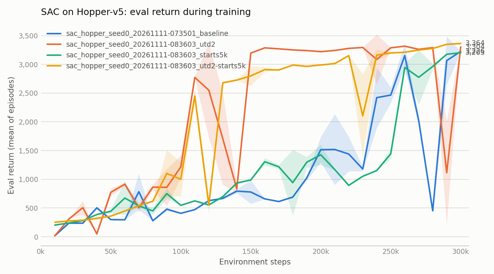
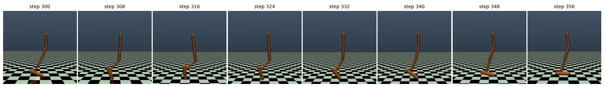
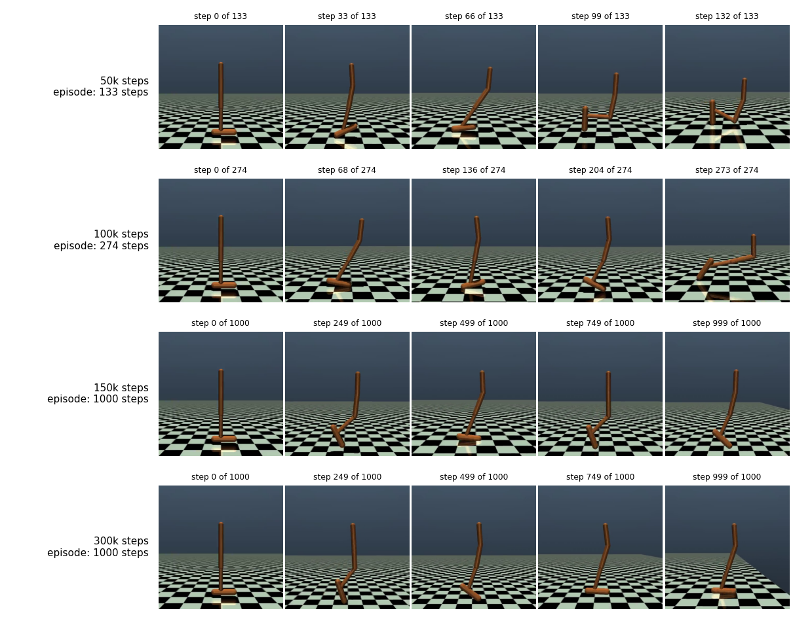

# Teaching a one-legged robot to hop: SAC on Hopper-v5

An experiment report on training Soft Actor-Critic (Stable-Baselines3) on the Gymnasium
`Hopper-v5` MuJoCo task, with resumable training and a small hyperparameter study.



*The best policy from this study (return 3360 over 10 evaluation episodes).*

## Summary

- SAC with default-style settings learns to hop for the full 1000-step episode in 300k
  environment steps, about 24 minutes on one RTX 3060. Evaluation return: 3228 +/- 3.
- Doubling the number of gradient updates per environment step (`gradient_steps=2`) reached
  a return of 2500 in 110-130k steps instead of 260k, but ended at about the same return.
- The four full-length runs finished between 3203 and 3364. None reached the Gymnasium
  reward threshold of 3800.
- Every result comes from a single seed (0). Differences in final return of this size are
  not evidence that one setting is better.
- Training can be stopped at any time and resumed; three of the four full-length runs were
  in fact paused partway and resumed.

## 1. Task

`Hopper-v5` is a planar one-legged robot with four body parts (torso, thigh, leg, foot)
and three actuated joints.

| | |
|---|---|
| Observation | 11 numbers (joint angles and velocities, torso height and angle) |
| Action | 3 joint torques, each in [-1, 1] |
| Reward per step | forward velocity + 1 for staying upright - a small control cost |
| Episode end | the robot falls (unhealthy state), or 1000 steps are reached |
| Reward threshold | 3800 |

A return above about 3000 means the robot stays up for all 1000 steps while moving forward.

## 2. Method

**Algorithm.** Soft Actor-Critic from Stable-Baselines3 2.9.2, with the automatic entropy
coefficient. Baseline settings (`configs/sac_hopper.toml`):

| Setting | Value |
|---|---|
| Total environment steps | 300,000 |
| Learning rate | 3e-4 |
| Replay buffer size | 300,000 |
| Random steps before updates (`learning_starts`) | 10,000 |
| Batch size | 256 |
| Discount (`gamma`) | 0.99 |
| Target update rate (`tau`) | 0.005 |
| Updates per environment step (`gradient_steps`) | 1 |
| Networks | 2 hidden layers of 256 units |
| Seed | 0 |

**Evaluation.** Every 10,000 steps the current policy is run for 5 episodes with
deterministic actions; the mean return is the "eval return" in the tables and curves.
The model with the highest eval return is saved as the best model and scored again
over 10 episodes at the end.

**Hardware and software.** One RTX 3060 (12 GB), Python 3.13, PyTorch 2.11, Gymnasium 1.4,
MuJoCo 4.0. Exact versions are in `requirements.txt`.

## 3. Experiments

| # | Experiment | Runs |
|---|---|---|
| 1 | Baseline | 1 run, 300k steps |
| 2 | Speed optimization | short benchmarks of device, CPU threads, grouped updates, `torch.compile` |
| 3 | First sweep | 6 settings, 100k steps each |
| 4 | Full-length candidates | the 3 most promising settings, 300k steps each |

## 4. Results

### 4.1 Baseline

| | |
|---|---|
| Training time | 24 min (209 steps per second) |
| Best model, 10 eval episodes | return 3228 +/- 3, all episodes reach the 1000-step limit |
| Reward threshold (3800) | not reached |



*Eval return during training. The band is +/- one standard deviation over the 5 eval episodes.*

The return stays below 1000 until about 190k steps, then rises quickly. It collapsed once
(452 at 280k) and recovered at the next evaluation, which is why the best model is saved
separately from the final one.

### 4.2 Speed optimization

- 93-96% of a training step is the gradient update; the MuJoCo simulation step takes
  about 0.1 ms.
- The GPU is about 1.3x faster than the CPU at this network size.
- Changing the CPU thread count, grouping updates, and `torch.compile` gave no reliable gain.
  Differences were inside the run-to-run noise of the machine (about +/-20% with a desktop
  in use); `torch.compile` and CPU-only training were slower.
- Decision: keep the default settings on the GPU.

### 4.3 First sweep (100k steps each)

| Variant | Change | Best eval | Last eval | Mean of last 3 |
|---|---|---|---|---|
| baseline | - | 784 | 408 | 388 |
| lr1e-3 | learning rate 3e-4 -> 1e-3 | 427 | 403 | 351 |
| starts5k | `learning_starts` 10k -> 5k | 750 | 546 | 582 |
| utd2 | 2 updates per env step | 1215 | 1215 | 980 |
| gamma0.98 | `gamma` 0.99 -> 0.98 | 356 | 347 | 341 |
| net400-300 | network 256x2 -> 400, 300 | 733 | 288 | 294 |

100k steps only shows early learning speed, because the baseline itself does most of its
learning after 190k steps. `utd2` and `starts5k` were carried forward, alone and combined.

### 4.4 Full-length candidates (300k steps each)

| Variant | Change | Best eval | Last eval | Mean of last 3 | First eval above 3000 |
|---|---|---|---|---|---|
| baseline | - | 3226 | 3226 | 2248 | 260k |
| starts5k | `learning_starts` 10k -> 5k | 3203 | 3203 | 3114 | 290k |
| utd2 | 2 updates per env step | 3317 | 3304 | 2570 | 150k |
| utd2-starts5k | both | 3364 | 3364 | 3330 | 210k |



*Eval return of the baseline and the three candidates.*

- **Final return is about the same.** All four runs end within about 160 of each other.
- **Learning speed differs clearly.** Both `gradient_steps=2` runs passed 2500 by 110-130k
  steps; the baseline and `starts5k` needed 260k.
- **Late collapses are common.** The baseline dropped to 452 at 280k, `utd2` to 1115 at 290k,
  and `utd2-starts5k` to 2104 at 230k. Each recovered by the next evaluation.
- **Best model overall** (`utd2-starts5k`), 10 eval episodes: return 3360 +/- 7, all episodes
  reach the 1000-step limit.

### 4.5 What the policy looks like

The frames below are from the `utd2-starts5k` run.



*The best policy in motion: 8 frames, 8 simulation steps apart (steps 300-356 of one episode).*



*The same run at four points in training, five frames spread over one episode each.
At 50k and 100k steps the robot falls after 133 and 274 steps; from 150k on it stays
up for the full 1000 steps.*

| Checkpoint | Episode return |
|---|---|
| 50k | 352 |
| 100k | 709 |
| 150k | 2906 |
| 200k | 2984 |
| 250k | 3214 |
| 300k | 3369 |

## 5. Discussion

- More gradient updates per environment step made learning about twice as fast in
  environment steps on this seed. Each step costs about 1.5x as long, so the benefit in
  wall-clock time depends on stopping earlier; that was not measured here, because the
  three candidate runs shared one GPU.
- No setting raised the final return. All runs plateau at 3200-3400, below the 3800
  threshold, so the remaining gap is probably not a matter of these two settings.
- Because single evaluations can collapse and recover, the last evaluation of a run is a
  poor summary. Keeping the best model, and reporting the mean of several evaluations,
  is more reliable.
- The default configuration was left unchanged: the advantage of `gradient_steps=2`
  is seen on one seed only.

## 6. Limitations

- **One seed.** Every number here comes from seed 0. Eval returns swing by hundreds between
  evaluations, so small differences may be chance.
- **Resumed runs.** The three candidate runs were paused and resumed. A resumed run continues
  correctly but is not bit-identical to an uninterrupted one (random state is not restored).
- **No clean timing for the candidates.** They ran three at a time at 57-99 steps per second,
  against 209 for the baseline alone.
- **Videos** were checked by sampling frames, not by watching every one end to end.

Possible follow-ups: repeat `gradient_steps=2` on 2-3 more seeds, time it alone, train
longer (500k steps) to see whether the return passes 3800, and compare with PPO and TD3.

## 7. Reproducing

Install the packages in `requirements.txt` into a Python 3.13 environment
(a conda env named `rl` was used here).

```bash
# Train (300k steps, about 25 min on an RTX 3060). Ctrl+C saves progress.
python train.py
python train.py --set sac.learning_rate=1e-3 --tag lr1e-3   # change one setting
python train.py --resume runs/<run_name>                    # continue a stopped run

# Watch training live
tensorboard --logdir runs

# Score a saved model and record videos
python evaluate.py runs/<run_name>                  # best model, 10 episodes
python evaluate.py runs/<run_name> --video          # + videos/best.mp4
python evaluate.py runs/<run_name> --video-stages   # one video per checkpoint

# Learning curves
python plot.py runs/<run_name>
python plot.py runs/<a> runs/<b> --out compare.png

# The two sweeps in this report (skips finished runs, resumes stopped ones)
python sweep.py configs/sweeps/first_sweep.toml --jobs 3
python sweep.py configs/sweeps/full_candidates.toml --jobs 3
```

The `runs/` folder (models, replay buffers, logs, videos) is not part of this repository;
the commands above recreate it.

### How resuming works

- Every 10k steps the model, the replay buffer, and `state.json` are saved to `resume/`
  (about 63 MB, 0.15 s). Files are written under a temporary name and then renamed,
  so a crash while saving keeps the previous snapshot.
- Ctrl+C saves at the current step. A hard kill or power loss falls back to the last
  snapshot (at most 10k steps lost).
- The eval log is appended to, and rows past the snapshot are dropped on resume,
  so the learning curve has no gaps or duplicates.

`python tests/check_resume.py` verifies both stop scenarios.

## 8. Repository layout

```
train.py, evaluate.py, plot.py, sweep.py   entry points
configs/sac_hopper.toml                    baseline settings
configs/sweeps/*.toml                      lists of variants to compare
hopper_sac/
  config.py       settings (TOML -> dataclass), run folder layout
  builders.py     environments and the SAC model
  checkpoint.py   resumable snapshots (model + replay buffer + state)
  callbacks.py    periodic eval, checkpoints, snapshots
  media.py        mp4 videos and learning-curve figures
assets/           figures used in this report
docs/progress.md  working notes and handoff
tests/            quick checks and benchmarks run before the real project
runs/<run_name>/  created by training (not in the repository)
  config.toml     settings used
  state.json      steps done, best score, status
  resume/         latest snapshot (overwritten every 10k steps)
  models/         best_model.zip, final_model.zip
  checkpoints/    step_050000.zip, ... (every 50k steps)
  logs/           tensorboard/, evals.csv, train_episodes.monitor.csv
  videos/, plots/
```
